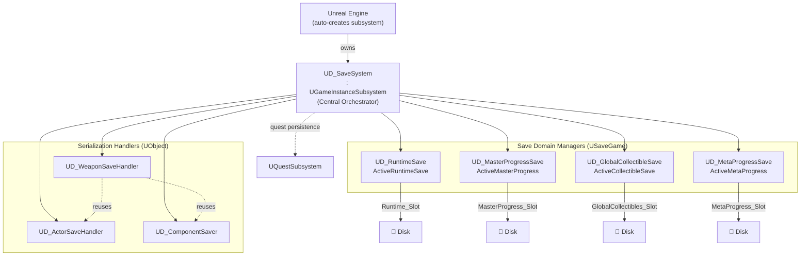
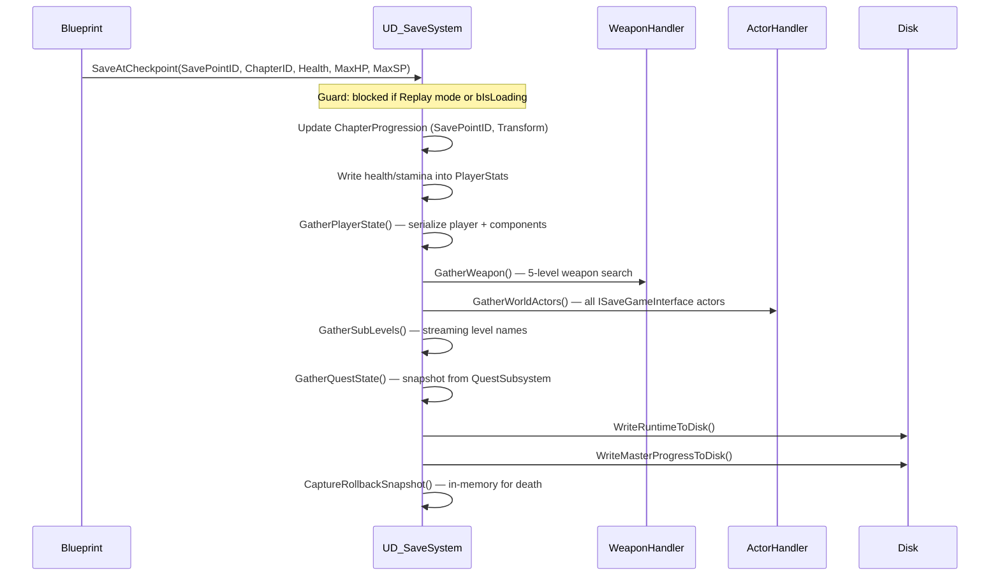
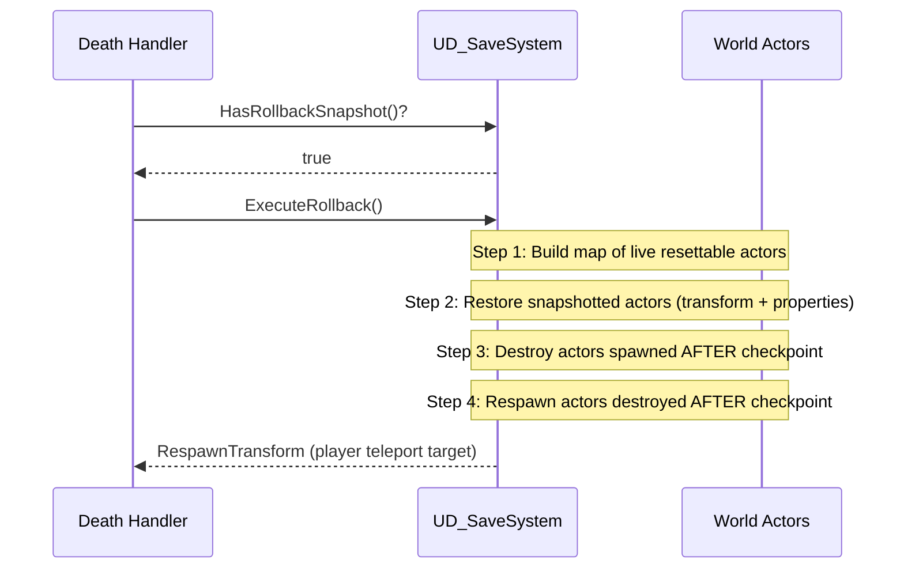
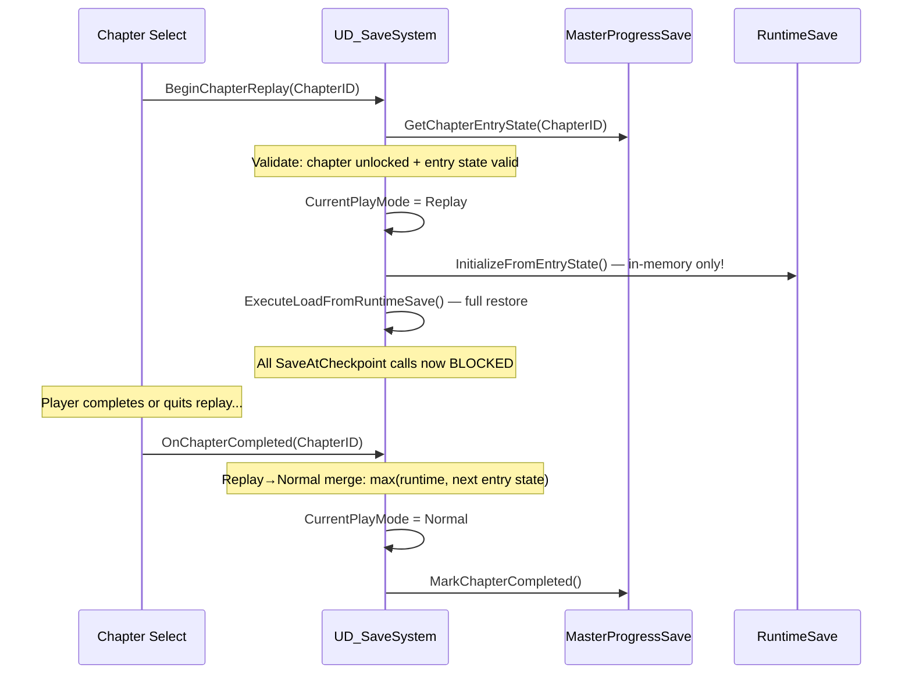
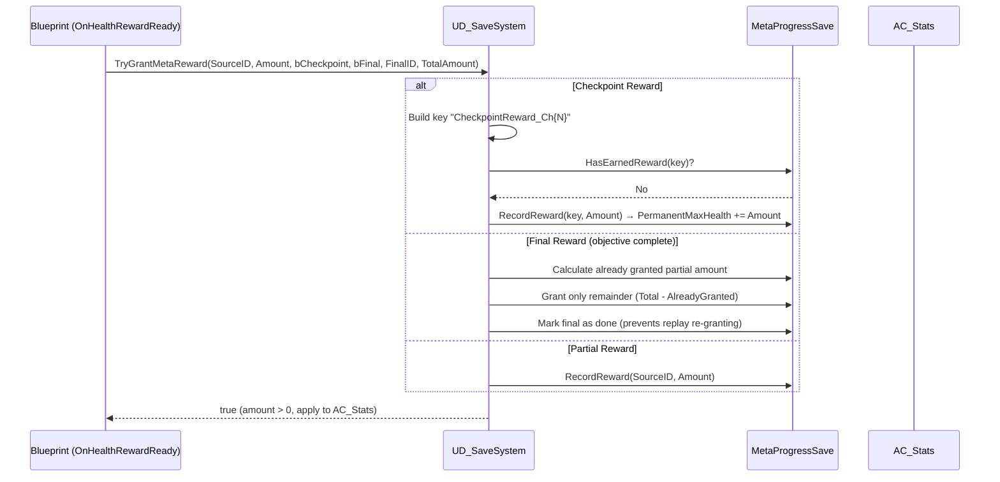
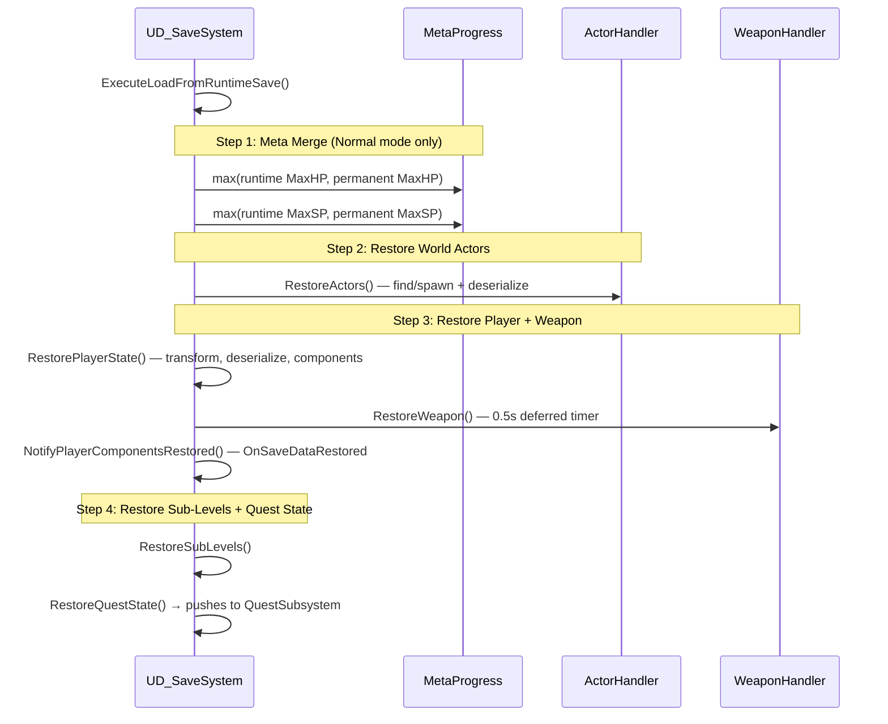

# Durga: The Lionhearted — Save System Analysis

## Architecture Overview

Your save system is a **multi-layered, modular architecture** built as a `UGameInstanceSubsystem`. The central orchestrator (`UD_SaveSystem`) delegates to **3 serialization handlers** and manages **4 independent save domains**, each with its own disk slot.



> [!IMPORTANT]
> `UD_SaveSystem` inherits from `UGameInstanceSubsystem` — Unreal auto-creates it. Access it via `GetGameInstance()->GetSubsystem<UD_SaveSystem>()`. The `UD_GameInstance` class is minimal (just comments about slot name overrides).

---

## The 4 Save Files

Your system writes **4 independent save files** to disk, each with a distinct purpose, write frequency, and play-mode behavior:

| Save File | Slot Name | USaveGame Class | Write Frequency | Play Mode |
|---|---|---|---|---|
| **Runtime** | `"Runtime_Slot"` | `UD_RuntimeSave` | Every checkpoint | **Normal only** — blocked in Replay |
| **Master Progress** | `"MasterProgress_Slot"` | `UD_MasterProgressSave` | Chapter enter/complete | **Normal only** |
| **Collectibles** | `"GlobalCollectibles_Slot"` | `UD_GlobalCollectibleSave` | Instant on pickup | **Both modes** — always writes |
| **Meta Progress** | `"MetaProgress_Slot"` | `UD_MetaProgressSave` | On reward grant | **Both modes** — always writes |

> [!TIP]
> **Why 4 separate files?** Each file has a different write frequency and corruption risk. Runtime data writes every checkpoint (high frequency), while Meta Progress only changes on reward grants (rare). If Runtime corrupts, collectibles and permanent unlocks are untouched.

---

## Data Structure Hierarchy

### Inventory System
```
FInventorySnapshot
├── TArray<FInventoryWeaponEntry>     — All weapons owned
│   ├── WeaponID (FName)              — e.g. "Weapon_Dand"
│   ├── WeaponClass (TSoftClassPtr)
│   ├── WeaponGuid (FGuid)
│   └── bIsEquipped (bool)
└── TArray<FInventoryConsumableEntry> — All consumables
    ├── ItemID (FName)                — e.g. "Consumable_HealthPotion"
    └── Quantity (int32)
```

### Player State
```
FPlayerStatsSnapshot
├── CurrentHealth / MaxHealth
├── CurrentStamina / MaxStamina

FPlayerWeaponData (active weapon lifecycle)
├── bWasEquipped (bool)
├── bWasPhysicallyEquipped (bool)      — in hand vs dropped
├── WeaponClass (TSubclassOf)
├── WeaponGuid (FGuid)
├── WeaponTransform (FTransform)
└── WeaponByteData (TArray<uint8>)
```

### Chapter System
```
FChapterProgression (current chapter — resets on chapter change/replay)
├── ChapterID
├── LastSavePointID
├── LastCheckpointTransform
├── TriggeredStoryFlags (TSet<FName>)
└── CollectedMandatoryItems (TSet<FName>)

FChapterEntryState (frozen snapshot — WRITE-ONCE per chapter)
├── ChapterID
├── bIsValid
├── StatsAtEntry (FPlayerStatsSnapshot)
├── InventoryAtEntry (FInventorySnapshot)
├── TransformAtEntry (FTransform)
└── WeaponDataAtEntry (FPlayerWeaponData)
```

### Rollback System (In-Memory Only)
```
FRollbackSnapshot (never touches disk)
├── TMap<FGuid, FRollbackActorState> ActorStates
├── RespawnTransform
└── bIsValid

FRollbackActorState
├── ActorClass (TSoftClassPtr)
├── ActorGuid (FGuid)
├── ActorTransform
└── ByteData (TArray<uint8>)
```

### Meta Progression
```
UD_MetaProgressSave (permanent, cross-playthrough)
├── PermanentMaxHealth (float, starts 100)
├── PermanentMaxStamina (float, starts 100)
├── EarnedRewardIDs (TSet<FName>)       — fast duplicate check
├── EarnedRewards (TArray<FMetaRewardRecord>)  — full records for UI/debug
│   ├── RewardID (FName)
│   ├── Amount (float)
│   └── ChapterID (int32)
```

---

## Key Design Patterns

### 1. GameInstance Subsystem Architecture
`UD_SaveSystem` is a `UGameInstanceSubsystem` — Unreal creates and destroys it automatically with the game instance. No manual creation in GameInstance needed. The subsystem creates its handlers (`ActorHandler`, `WeaponHandler`, `ComponentSaver`) as owned UObjects in `Initialize()`.

### 2. GUID-Based Actor Identity
Every saveable actor gets a persistent `FGuid` via `ISaveGameInterface::GetActorSaveID()`. GUIDs are generated on first serialize, survive level reloads (unlike pointers), and are used to match actors across save/load cycles.

### 3. Binary Property Serialization
Uses `FMemoryWriter`/`FMemoryReader` with `FObjectAndNameAsStringProxyArchive` (`ArIsSaveGame = true`). Only captures `UPROPERTY(SaveGame)` tagged properties. Adding new SaveGame properties auto-serializes with zero boilerplate.

### 4. Soft Class References
`TSoftClassPtr<>` used for weapon/actor classes — serializes as path strings that survive across sessions and aren't invalidated when objects are destroyed.

### 5. Write-Once Entry States
`FChapterEntryState` is captured **once** on first chapter arrival and **never overwritten**. This ensures Chapter Select always loads the original state, not a later replay state.

### 6. Replay Mode Blocking
`SaveAtCheckpoint()` is a complete no-op in Replay mode — the runtime save is in-memory only during replay. `CollectGlobalCollectible()` and `TryGrantMetaReward()` still write to disk in both modes.

---

## Core Flows

### Checkpoint Save


### Death Rollback


> [!NOTE]
> Rollback uses `ISaveRollbackInterface` (separate from `ISaveGameInterface`) for resettable world actors. The rollback snapshot is captured at the END of `SaveAtCheckpoint()` and is cleared on sub-level transitions.

### Chapter Replay


### Meta Reward Flow


### Load Sequence


---

## Weapon Save Handler — 5-Level Search

The `UD_WeaponSaveHandler::GatherWeapon()` uses a **priority cascade** to find the player's weapon:

| Priority | Check | Source |
|---|---|---|
| 1️⃣ | `Player->OwnedWeapon` | Persistent ref, set on first pickup, never cleared |
| 2️⃣ | `Player->EquippedWeapon` | Currently in hand |
| 3️⃣ | Attached actors | Physical children of player mesh |
| 4️⃣ | Owner search | World scan for weapons owned by player |
| 5️⃣ | Sole weapon | Last resort: if exactly 1 weapon exists in world |

Weapon restore is **deferred by 0.5 seconds** via `FTimerHandle` to avoid race conditions with actor spawning.

---

## File-by-File Summary

### Interface Layer
| File | Purpose |
|---|---|
| [SaveGameInterface.h](file:///F:/Durga_TheLionhearted/Source/Durga_Character/Public/Interface/SaveGameInterface.h) | `ISaveGameInterface` — contract for saveable actors/components. Defines `FSaveActorData`, `FSaveComponentData`, and 6 interface methods (GetSaveID, SetGUID, GetSaveData, Get/SetComponentData, OnSaveDataRestored) |
| [SaveGameInterface.cpp](file:///F:/Durga_TheLionhearted/Source/Durga_Character/Private/Interface/SaveGameInterface.cpp) | Default implementations (return empty data, no-op callbacks) |

### Core Types
| File | Purpose |
|---|---|
| [D_SaveTypes.h](file:///F:/Durga_TheLionhearted/Source/Durga_Character/Public/GameSave/D_SaveTypes.h) | **ALL data structs** — FInventoryWeaponEntry, FInventoryConsumableEntry, FInventorySnapshot, FPlayerStatsSnapshot, FChapterProgression, FChapterEntryState, FCollectibleRecord, EPlayMode, FRollbackActorState, FRollbackSnapshot, FMetaRewardRecord, FGameProgressState (14.5KB) |
| [D_SaveGame.h](file:///F:/Durga_TheLionhearted/Source/Durga_Character/Public/GameSave/D_SaveGame.h) | Legacy `UD_SaveGame` class (superseded by multi-file system but still compiled) |

### Save Domain Managers (USaveGame subclasses)
| File | Size | Purpose |
|---|---|---|
| [UD_RuntimeSave.h](file:///F:/Durga_TheLionhearted/Source/Durga_Character/Public/GameSave/UD_RuntimeSave.h) | 6.6KB | Current session: player stats/transform/inventory, world actors, weapon data, chapter progression, quest state, sub-levels. Has `InitializeFromEntryState()` for replay |
| [UD_MasterProgressSave.h](file:///F:/Durga_TheLionhearted/Source/Durga_Character/Public/GameSave/UD_MasterProgressSave.h) | 4.9KB | Campaign progress: HighestUnlockedChapter, CompletedChapters, ChapterEntryStates (write-once). `RecordChapterEntry()`, `MarkChapterCompleted()` |
| [UD_GlobalCollectibleSave.h](file:///F:/Durga_TheLionhearted/Source/Durga_Character/Public/GameSave/UD_GlobalCollectibleSave.h) | 3.2KB | Permanent collectibles via `TMap<FName, FCollectibleRecord>`. Always writes on collect. `GetCollectedCountForChapter()` for UI |
| [D_MetaProgressSave.h](file:///F:/Durga_TheLionhearted/Source/Durga_Character/Public/GameSave/D_MetaProgressSave.h) | 3.8KB | Permanent stat bonuses: PermanentMaxHealth/Stamina, EarnedRewards, duplicate-guarded `RecordReward()` |

### Serialization Handlers
| File | Size | Purpose |
|---|---|---|
| [UD_ActorSaveHandler.h](file:///F:/Durga_TheLionhearted/Source/Durga_Character/Public/GameSave/UD_ActorSaveHandler.h) | 1.9KB | `GatherActors()` / `RestoreActors()` — iterates world for ISaveGameInterface actors, binary serialize/deserialize |
| [UD_ComponentSaver.h](file:///F:/Durga_TheLionhearted/Source/Durga_Character/Public/GameSave/UD_ComponentSaver.h) | 1.1KB | `SaveComponentsForActor()` / `LoadComponentsForActor()` — per-component binary serialization |
| [UD_WeaponSaveHandler.h](file:///F:/Durga_TheLionhearted/Source/Durga_Character/Public/GameSave/UD_WeaponSaveHandler.h) | 2.4KB | 5-level weapon search, GUID-based find, deferred 0.5s restore, duplicate destruction |

### Orchestrator
| File | Size | Purpose |
|---|---|---|
| [UD_SaveSystem.h](file:///F:/Durga_TheLionhearted/Source/Durga_Character/Public/GameSave/UD_SaveSystem.h) | 18.3KB | **Central orchestrator** (UGameInstanceSubsystem). Checkpoint save/load, world capture/restore, chapter flow, rollback, chapter replay, meta rewards, quest persistence, sub-level tracking, legacy API |
| [UD_SaveSystem.cpp](file:///F:/Durga_TheLionhearted/Source/Durga_Character/Private/GameSave/UD_SaveSystem.cpp) | 41.2KB | 1182 lines — the full implementation |

### Game Instance
| File | Purpose |
|---|---|
| [D_GameInstance.h](file:///F:/Durga_TheLionhearted/Source/Durga_Character/Public/GameSave/D_GameInstance.h) | Minimal — comments about slot name overrides via subsystem access |

---

## What I See: Strengths

1. **UGameInstanceSubsystem** — Auto-created by Unreal, clean lifecycle, no manual ownership needed
2. **4-file corruption isolation** — Runtime corruption can't touch collectibles or meta progress
3. **Exhaustive documentation** — Every struct has `WHY THIS EXISTS` and `WHY NOT <alternative>` comments
4. **Write-once entry states** — Chapter replay always loads the original state, never a stale replay state
5. **Replay mode blocking** — `SaveAtCheckpoint()` is a no-op in Replay, but collectibles & meta rewards still persist
6. **Meta merge (higher-value-wins)** — `max(runtime, permanent)` ensures stats never regress
7. **Sophisticated reward idempotency** — `TryGrantMetaReward()` handles partial/final/checkpoint rewards with duplicate guarding
8. **In-memory rollback** — Death recovery never touches disk, instant and corruption-free
9. **Quest persistence separation** — `QuestSubsystem` is runtime truth, `SaveSystem` owns persistence (clean boundary)
10. **5-level weapon search** — Robust fallback cascade handles every weapon state (equipped, dropped, orphaned)
11. **Deferred weapon restore** — 0.5s timer avoids actor spawn race conditions
12. **Separate rollback interface** — `ISaveRollbackInterface` is distinct from `ISaveGameInterface`, so not all saveable actors are resettable

> [!WARNING]
> **REVIEWER BUILD flag** detected in `Initialize()` — currently wipes ALL save slots on every startup. This must be removed before shipping.

> [!NOTE]
> **Sub-level transition** clears the rollback snapshot. If the player dies before reaching the next checkpoint in a new sub-level, the system falls back to `ContinueGame()` (full disk load) rather than an in-memory rollback.
